# 图库选择器

### 最新版本 

* 使用最新版的 filepicker 库，必须使用最新版的xwidget库。都是 5.8.1 以上确保。

* 用了很多，都没有丝滑的选择效果的开源库，滑动选择丝滑。闲来没事，随手写一个吧。

* 图库选择，文件选择

* 仿华为相册滑动选择手势逻辑，

* 微信选择库样式风格，完全防微信，图片编辑功能对齐，头像剪裁，超越微信的更多场景。

* 支持多选，限制数量，不限制数量。

* 选择条件可限定：图片 / 视频**各自限量**（如图片 9 张、视频 1 个），可以要求**必须选够**，\
  也能让图片和视频**只能选其中一类**（互斥）。见「[按类型限量](#6-按类型限量图片-n-张--视频-m-个--互斥)」一节。

* 使用场景，多用于 视频剪辑选择库，相册管理选择库，朋友圈选图或者视频。

### 好不好用，直接安装。

* 扫码：

* 或者：点击下载 [app-debug.apk](app/release/app-debug.apk)

> demo 已经按「使用场景」重构，每个场景各自选项 + 「开始」+ 结果展示，互不干涉：\
> **普通选择 / 规则 / 文件 / 头像裁剪 / 点击编辑 / 预览编辑 / 拍照直出 / 录像直出**。

## 功能总览

> 按重要度排序：先"选图"，再"编辑"，再"头像裁剪"，最后是外围能力。

| 优先级 | 能力                 | 说明                                                     | 入口                                                 |
| --- | ------------------ | ------------------------------------------------------ | -------------------------------------------------- |
| 1   | **图片 / 视频 / 文件选择** | 图库网格、滑动选择、单选/多选、数量与大小限制                                | [基本用法](#二基本用法)                                     |
| 2   | **图片编辑**           | 画笔（涂鸦）、文字、裁剪、马赛克；会话级覆盖不改原图，完成后发布相册；支持「点击即编辑」           | [3.1 图片编辑](#31-图片编辑画笔--文字--裁剪--马赛克)                |
| 3   | **头像裁剪**           | `setAvatarCropMode(true)`；支持固定比例/自由裁剪，框可拖拽、可锁比例、初始大小可调 | [3.2 头像裁剪](#32-头像裁剪独立裁剪页)                          |
| 4   | **预览**             | 单图预览（可编辑）、多选预览（可逐张编辑）、底部已选缩略图条                         | [基本用法](#二基本用法)                                     |
| 5   | **分类型限量 / 互斥**     | 「图片 9 张 + 视频 1 个」「必须选够」「二选一」                           | [基本用法 §6](#6-按类型限量图片-n-张--视频-m-个--互斥)              |
| 6   | **相机入口 / 直接相机**    | 网格内拍照入口；`setOpenCameraDirect` **完全不经过列表**（仅图片/视频）      | [3.3 直接相机](#33-直接打开相机完全不经过图片列表)                    |
| 7   | **多类型文件**          | 音频、文档、PDF、APK、压缩包、自定义后缀                                | [基本用法 §3](#3-选择文件音频--文档--压缩包)                      |
| 8   | **UI 配置 / 多语言**    | 文案、颜色、图标、编辑页完整 i18n                                    | [FilePickerUIConfig](#ui-自定义配置-filepickeruiconfig) |
| 9   | **编辑产物 / 缓存**      | 成品发布到 `Pictures/filepicker/`，返回真实路径；临时缓存返回时异步清理        | [编辑结果说明](#编辑结果说明)                                  |

## 功能展示

> 以下截图均来自 demo（`app/`），点击图片可看大图；完整交互直接运行 demo 体验。

### demo 首页：多个界面分别展示 不同场景用法。

<table>
<tr><td align="center"><a href="docs/images/demo-tab-basic.jpg">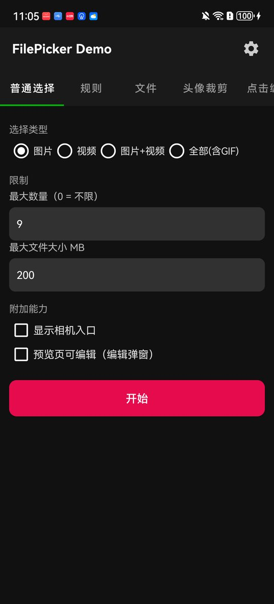</a><br/>普通选择</td><td align="center"><a href="docs/images/demo-tab-rules.jpg">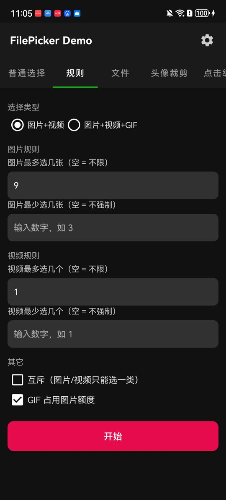</a><br/>规则</td><td align="center"><a href="docs/images/demo-tab-files.jpg">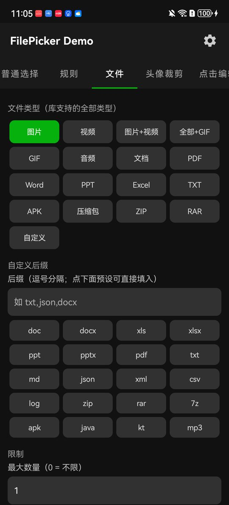</a><br/>文件</td><td align="center"><a href="docs/images/demo-tab-avatar.jpg">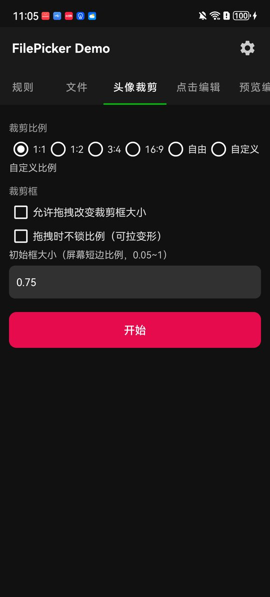</a><br/>头像裁剪</td></tr>
<tr><td align="center"><a href="docs/images/demo-tab-edit-on-click.jpg">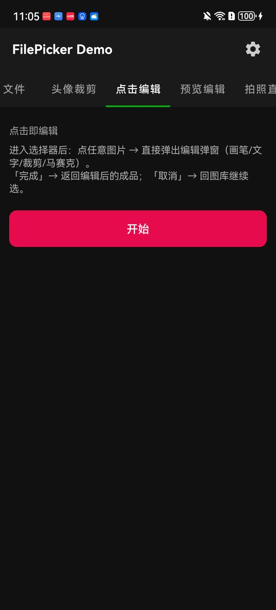</a><br/>点击编辑</td><td align="center"><a href="docs/images/demo-tab-edit-preview.jpg">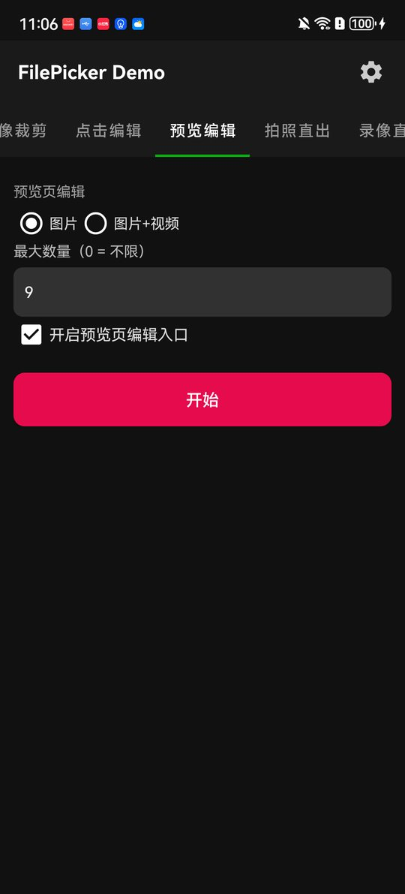</a><br/>预览编辑</td><td align="center"><a href="docs/images/demo-tab-direct-photo.jpg">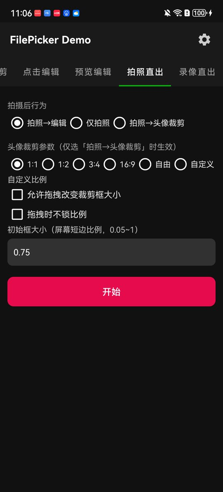</a><br/>拍照直出</td><td align="center"><a href="docs/images/demo-tab-direct-video.jpg">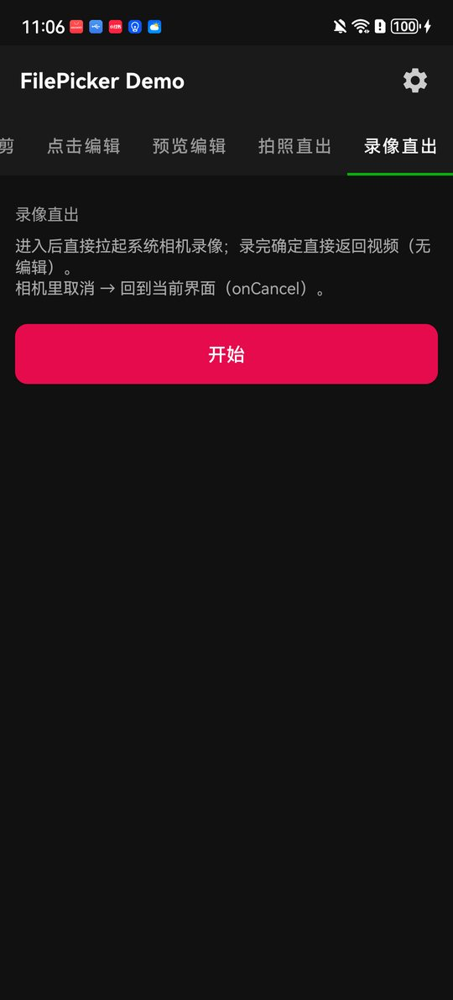</a><br/>录像直出</td></tr>
</table>

### 图片选择与预览

<table>
<tr><td align="center"><a href="docs/images/picker-image-grid.jpg">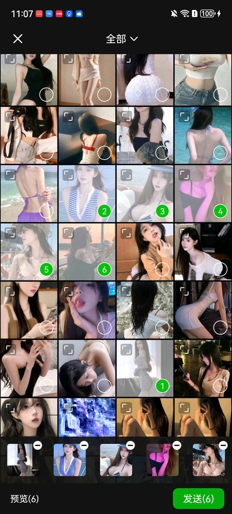</a><br/>多选网格（已选 6 张）</td><td align="center"><a href="docs/images/picker-preview.jpg"></a><br/>大图预览 / 编辑入口</td></tr>
</table>

### 图片编辑（画笔 / 文字 / 裁剪 / 马赛克）

<table>
<tr><td align="center"><a href="docs/images/editor-brush.jpg"></a><br/>画笔</td><td align="center"><a href="docs/images/editor-brush-color.jpg"></a><br/>画笔颜色/粗细</td><td align="center"><a href="docs/images/editor-text.jpg"></a><br/>文字输入</td><td align="center"><a href="docs/images/editor-text-done.jpg"></a><br/>马赛克（像素/模糊）</td></tr>
</table>

### 头像裁剪

<table>
<tr><td align="center"><a href="docs/images/demo-tab-avatar.jpg"></a><br/>头像裁剪参数</td><td align="center"><a href="docs/images/file-list-pdf.jpg"></a><br/>头像剪裁</td></tr>
</table>

### 文件选择（音频 / 文档 / PDF / APK / 压缩包 / 自定义后缀）

<table>
<tr><td align="center"><a href="docs/images/file-list-docs.jpg">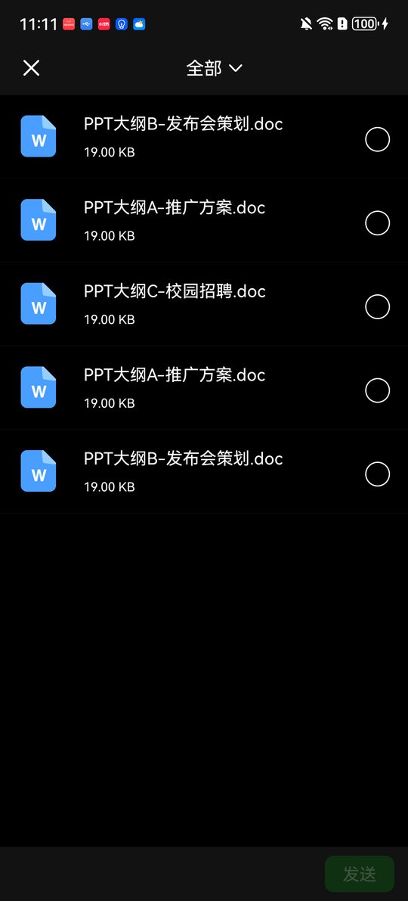</a><br/>单独Word 文档 </td><td align="center"><a href="docs/images/file-list-word.jpg">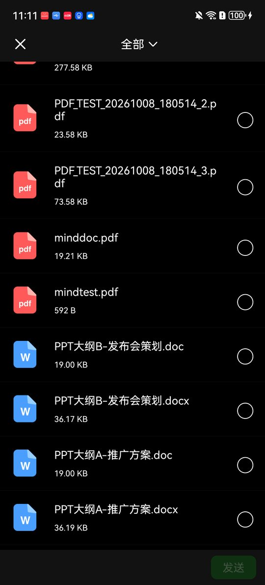</a><br/>PDF / 文档混排</td><td align="center"><a href="docs/images/editor-mosaic.jpg">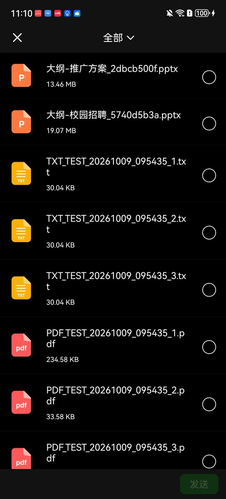</a><br/>PDF,DOC,DOCX多类型</td></tr>
</table>

***

## 目录

| 章节                         | 内容                                                         |
| -------------------------- | ---------------------------------------------------------- |
| [一、快速接入](#一快速接入)           | 依赖版本、Gradle 接入                                             |
| [二、基本用法](#二基本用法)           | Activity / Fragment 启动、选择文件、拍照、分类型限量                       |
| [三、功能模块](#三功能模块)           | 图片编辑（画笔/文字/裁剪/马赛克）、头像裁剪                                    |
| [四、API 文档](#四api-文档)       | FilePicker、Builder、FilePickerSelectType、FilePickerUIConfig |
| [五、常见问题与温馨提示](#五常见问题与温馨提示) | 常见坑与建议                                                     |
| [特别鸣谢](#特别鸣谢)              | 依赖的开源库                                                     |
| [版本记录](#版本记录)              | 各版本升级日志                                                    |

## 一、快速接入

### 1.1 依赖与版本

#### 依赖说明

* 下面的这个三方库，本maven仓库中的aar都过滤掉了。建议自己从下面引用，防止库冲突。

#### 版本列表

1. \*\*filepicker\
   \*\* 
2. \*\*[xwidget](https://github.com/pichsy/xwidget)\
   \*\*  
3. \*\*BRV\
   \*\*  
4. \*\*BasePopup\
   \*\* 
5. **androidx.media3** 这里建议使用***1.11.0***\
   稳定版 
6. **glide** 

```kotlin
dependencies {
    // 基础组件库 （必须）
    implementation("com.gitee.pichs:filepicker:8.1.0")

    // 基础组件库 （必须）
    implementation("com.gitee.pichs:xwidget:5.8.1")

    // glide 图片加载 （必须）
    implementation("com.github.bumptech.glide:glide:4.16.0")

    //基础库（必须）
    implementation(libs.androidx.core.ktx)
    implementation(libs.androidx.appcompat)
    implementation(libs.androidx.activity.ktx)
    implementation(libs.androidx.fragment.ktx)
    implementation(libs.material)
    implementation(libs.androidx.recyclerview)
    implementation(libs.androidx.annotation)
    implementation(libs.kotlinx.coroutines.android)
    implementation(libs.kotlinx.coroutines.core)

    // brv （必须）
    implementation("com.github.liangjingkanji:BRV:1.6.1")
    // 弹窗 （必须）
    implementation("io.github.razerdp:BasePopup:3.2.1")
    // 视频播放库 （必须）采用exoplayer
    implementation("androidx.media3:media3-exoplayer:1.7.1")
    implementation("androidx.media3:media3-ui:1.7.1")
}

使用libs.version.toml用户引入方式
dependencies {
    api(libs.filepicker)
    api(libs.xwidget)
    api(libs.glide)
    api(libs.brv)
    api(libs.basepopup)
    api(libs.media3.exoplayer)
    api(libs.media3.ui)
}

#### libs.versions.toml 写法
[versions]
xwidget="5.8.1"
filepicker="8.1.0"
brv="1.6.1"
basepopup="3.2.1"
glide="4.16.0"
activityKtx="1.9.0"
fragmentKtx="1.6.2"
recyclerview="1.4.0"
kotlinxCoroutinesAndroid="1.7.3"
kotlinxCoroutinesCore="1.7.3"
media3Exoplayer="1.7.1"

[libraries]
androidx-media3-exoplayer={module="androidx.media3:media3-exoplayer",version.ref="media3Exoplayer"}
androidx-media3-ui={module="androidx.media3:media3-ui",version.ref="media3Exoplayer"}
androidx-activity-ktx={group="androidx.activity",name="activity-ktx",version.ref="activityKtx"}
androidx-fragment-ktx={group="androidx.fragment",name="fragment-ktx",version.ref="fragmentKtx"}
androidx-recyclerview={group="androidx.recyclerview",name="recyclerview",version.ref="recyclerview"}
kotlinx-coroutines-android={group="org.jetbrains.kotlinx",name="kotlinx-coroutines-android",version.ref="kotlinxCoroutinesAndroid"}
kotlinx-coroutines-core={group="org.jetbrains.kotlinx",name="kotlinx-coroutines-core",version.ref="kotlinxCoroutinesCore"}
xwidget={group="com.gitee.pichs",name="xwidget",version.ref="xwidget"}
filepicker={group="com.gitee.pichs",name="filepicker",version.ref="filepicker"}
basepopup={group="io.github.razerdp",name="BasePopup",version.ref="basepopup"}
brv={group="com.github.liangjingkanji",name="BRV",version.ref="brv"}
glide={group="com.github.bumptech.glide",name="glide",version.ref="glide"}

```

## 二、基本用法

### 1. 在 Activity 中启动

```kotlin
FilePicker.with(this) // this: FragmentActivity
    .setSelectType(FilePickerSelectType.ofImage()) // 设置选择类型
    .setMaxSelectNumber(9) // 设置最大选择数量
    .setSlideChooseEnable(true) // 开启滑动选择
    .setOnSelectCallback(object : OnSelectCallback {
        override fun onSelectedCallback(isUseOriginal: Boolean, list: MutableList<MediaEntity>) {
            // 选择完成回调
            println("是否使用原图: $isUseOriginal")
            list.forEach {
                println("文件路径: ${it.path}")
            }
        }
        override fun onCancel() {
            // 取消选择
        }
    })
    .setUiConfig(
        FilePickerUIConfig(
            isHideSelectTab = false,
            allAlbumName = "全部",
            confirmBtnText = "发送",
            isShowOriginal = false,
            isPreviewPageIndexMode = true,
            isShowSelectedListDeleteIcon = true,
            folderNickNameMap = hashMapOf(
                "DCIM" to "相册"
            )
        )
    ).
    .start()
```

### 2. 在 Fragment 中启动

```kotlin
FilePicker.with(this) // this: Fragment
    .setSelectType(FilePickerSelectType.ofImage())
    .setMaxSelectNumber(5)
    .setMaxFileSize(50 * 1024 * 1024) // 50MB
    .setMinFileSize(1 * 1024) // 1KB
    .setOnSelectCallback { isUseOriginal, list ->
        // 选择完成回调
    }
    .setUiConfig(
        FilePickerUIConfig(
            isHideSelectTab = true,
            allAlbumName = "全部",
            confirmBtnText = "下一步",
            isShowOriginal = false,
            isPreviewPageIndexMode = true,
            isShowSelectedListDeleteIcon = true,
            folderNickNameMap = hashMapOf(
                "DICM" to "相机",
                "Download" to "下载"
            )
        )
    ).
    .start()
```

### 3. 选择文件（音频 / 文档 / 压缩包）

```kotlin
FilePicker.with(this)
    .setSelectType(FilePickerSelectType.ofAudio()) // 文件类型：ofAudio/ofDocument/ofPdf/ofApk/ofZipAll...
    .setMaxSelectNumber(1)
    .setSingleClickEnable(true) // 单击直接返回，文件选择场景常用
    .setOnSelectCallback { isUseOriginal, list ->
        // 返回 MediaEntity（含 path/name/mimeType/size）
    }
    .start()
```

### 4. 自定义后缀过滤

任意后缀组合，不需要为每种后缀单独加类型：

```kotlin
FilePicker.with(this)
    .setSelectType(FilePickerSelectType.ofExtensions("xz", "tar", "bak"))
    .start()
```

> 有专属类型入口的后缀（图片、音频、文档、核心压缩包等）优先用 `ofXxx()`，\
> 两者在 UI 模式与预览上的差异见下方 [类型入口怎么选](#类型入口怎么选)。

详见下方 [自定义后缀过滤](#自定义后缀过滤)。

### 5. 拍照 / 录像入口（默认关闭）

在网格第一格放一个"相机"格子，点击调起**系统相机**拍照或录像，拍完自动插到列表第一个。

```kotlin
FilePicker.with(this)
    .setSelectType(FilePickerSelectType.ofImage())  // 或 ofVideo()
    .setShowCameraEntry(true)
    .start()
```

**默认** **`false`**：不开启时这条链路完全不参与 —— 不占列表格子、不注册 viewType、不请求权限，\
对宿主等同于不存在。

生效条件：`setShowCameraEntry(true)`，且当前类型下相机**能产出点东西**（图片或视频）。\
GIF / 音频 / 文档不显示；有 tab 的类型里入口**跟着当前 tab 走**。

格子的画法按"能产出几种"决定：

| 当前生效类型                                       | 格子                    |
| -------------------------------------------- | --------------------- |
| 只有图片（`ofImage()`，或 `ofAll()` 的「图片」页）         | 整格 = 拍照               |
| 只有视频（`ofVideo()`，或 `ofAll()` 的「视频」页）         | 整格 = 录像               |
| 图片 + 视频（`ofAll()` / `ofAllWithGif()` 的「全部」页） | **从中间劈开**：左半边录像、右半边拍照 |
| 只有 GIF（「GIF」页）                               | 不显示入口                 |

行为说明：

| 项      | 说明                                                                        |
| ------ | ------------------------------------------------------------------------- |
| 位置     | 网格左上角第一格，随列表滚动，尺寸与相邻格子一致                                                  |
| 点击     | 调起系统相机（拍照 `ACTION_IMAGE_CAPTURE` / 录像 `ACTION_VIDEO_CAPTURE`）             |
| 拍完     | 自动插到列表**第一个**位置，并**默认勾选上**（"这张就是要用的"）                                     |
| 已到上限   | 仍然插入，但**不勾选**（不会超过 `maxSelectNumber`），并 toast 提示                          |
| 单选立即返回 | `maxSelectNumber == 1` 且开了 `setSingleClickEnable(true)` 时，拍完**直接回调返回**，\\ |

```
           拍到的这张会**替换**掉已有选择（宿主通过 `setSelectedList` 预置的那张也一样）              |
```

| 大小超限       | 产物不符合 `minFileSize` / `maxFileSize` 时**不插入、不勾选**，toast 提示（文案见\
`cameraEntrySizeLimitToastContent`）                                  |\
\| 产物落地       | 写进系统相册（`DCIM/Camera`），和系统相机拍的照片放在一起                                  |\
\| 取消拍摄       | 会清理掉本次产生的空记录/空文件，不会在相册里留下打不开的空条目                                   |\
| 图标与文案      | 图标默认用库内资源，可换 `cameraEntryIconResId`（拍照）/ `cameraEntryVideoIconResId`（录像）；\
文字标签用 `cameraEntryPhotoText` / `cameraEntryVideoText`              |

**权限与 manifest**：

* 库**不声明也不占用** CAMERA 权限 —— 拍摄由相机 App 自己完成，调用方不需要该权限。\
  但如果**宿主 App 自己声明了** `android.permission.CAMERA` 却还没授权，`ACTION_IMAGE_CAPTURE` /\
  `ACTION_VIDEO_CAPTURE` 会直接抛 `SecurityException`（系统规定）。这种情况下库会**先申请权限**，\
  授权后自动继续拍摄。真机实测原话（华为 BRE-AL80 / Android 12，宿主声明了但未授权）：\
  `Permission Denial: starting Intent { act=android.media.action.VIDEO_CAPTURE ... } with revoked permission android.permission.CAMERA`

* 库**不往宿主 manifest 里加任何东西**（没有 `<provider>`、没有 `<queries>`）。

* 产物写入系统相册：**Android 10+ 不需要任何存储权限**；Android 7.0–9 需要 `WRITE_EXTERNAL_STORAGE`\
  （与本库查询相册本身的前提一致）。

> **为什么不用** **`resolveActivity()`** **判断有没有相机 App**（官方文档推荐这么写）：\
> 宿主 targetSdk ≥ 30 时，没声明 `<queries>` 的应用会被包可见性过滤，`resolveActivity()` /\
> `queryIntentActivities()` 对这几个相机 action **一律返回 null / 0**，但 `startActivity` 依然能成功。\
> 同一台华为设备上实测：四个相机 action 的 `resolveActivity` 全是 `null`，而实际能起\
> `com.huawei.camera/com.android.camera.VideoCamera`。用 `resolveActivity() != null` 当守卫\
> 会让相机入口**永远点不动**。本库因此改成 `startActivity` 包 try/catch。

***

### 6. 按类型限量（图片 N 张 / 视频 M 个 / 互斥）

`setMaxSelectNumber` 只能管一个总数。7.2.0 起新增**按类型分别限量**：图片、视频各自设上限，\
可以要求"必须选够"，也可以要求"图片和视频只能选其中一类"。

```kotlin
FilePicker.with(this)
    .setSelectType(FilePickerSelectType.ofAll())
    .setSelectRules(
        SelectRule.ofImage(0, 9),   // 图片最多 9 张（min = 0 表示不强制）
        SelectRule.ofVideo(0, 1),   // 视频最多 1 个
    )
    .start()
```

`SelectRule.ofImage(min, max)` / `ofVideo(min, max)` / `ofGif(min, max)`：

* `max`：该类型的**硬上限**，到顶后勾不上，提示"图片最多选择2个"；

* `min > 0`：**必须选**。提交时数量必须落在 `min..max` 内；不满足时确定按钮**不高亮**，\
  点击提示"图片必须选3个"，且不会返回；

* 没配规则的类型**不受限制**。

| 需求                    | 写法                                                                   |
| --------------------- | -------------------------------------------------------------------- |
| 图片 ≤ 9、视频 ≤ 1，可混选     | `setSelectRules(SelectRule.ofImage(0, 9), SelectRule.ofVideo(0, 1))` |
| 图片必须正好 9 张            | `setSelectRules(SelectRule.ofImage(9, 9))`                           |
| 视频必须 1 个、图片最多 9 张     | `setSelectRules(SelectRule.ofVideo(1, 1), SelectRule.ofImage(0, 9))` |
| 图片和视频**只能选其中一类**      | 上面的规则 + `.setExclusive(true)`                                        |
| 合计最多 5 个（不分类，**旧模型**） | `.setMaxSelectNumber(5)`（**配了规则后无效**：不互斥=各 `max` 累加，互斥=取最大 `max`）    |
| GIF 不占图片额度            | `.setGifCountsAsImage(false)`                                        |

> ⚠️ **`setMaxSelectNumber`** **是旧模型的"合计上限"**：只要调用了 `setSelectRules(...)`，\
> 这个数字就**完全不生效**（库会打 warn 日志），最终合计上限由规则推导，**互斥与否算法不同**：
>
> | 规则形态                                 | 合计上限算法                        | 示例（图片 max=9、视频 max=1） |
> | ------------------------------------ | ----------------------------- | --------------------- |
> | **不互斥**（默认）                          | 各类型 `max` **累加**              | 最多 **10** 个           |
> | **互斥**（`setExclusive(true)`）         | 取各类型 `max` 的**最大值**           | 最多 **9** 个（只能选一类）     |
> | 某个类型 `max` 设为不限（`Int.MAX_VALUE`，默认值） | 合计**不限**                      | 不限                    |
> | 一个规则都没配                              | 回退旧模型，`setMaxSelectNumber` 生效 | —                     |
>
> 所以上面例子写 `setMaxSelectNumber(5)` 没有任何作用：不互斥时上限是 10、互斥时是 9。\
> 新项目直接用规则表达即可，不要再传第二个数字。

**互斥（`setExclusive(true)`）的锁定规则**：

* 只有一类配了 `min > 0` → 直接锁定那一类，另一类点了会被拦下（等于"只能选图片 / 只能选视频"）；

* 两类都配了 `min > 0` → **先点哪类就锁定哪类**，另一类的"必须选"本次作废；

* 已选类型全部取消后**自动解锁**，可以改选另一类。

**启用条件（重要）**：`setExclusive(...)` 和 `setGifCountsAsImage(...)` **只有在配置了\
`setSelectRules(...)`** **之后才生效**。一个规则都不配时，它们会被忽略（打 warn 日志），\
数量限制仍由 `setMaxSelectNumber(n)` 决定 —— 这样"只开互斥、没配规则"不会把你设的最大数量弄丢。

**和** **`setMaxSelectNumber`** **的关系**：**用了规则，`setMaxSelectNumber`** **就不生效了**。\
数量限制始终只有一个来源：

* 不用规则 → `setMaxSelectNumber(n)` 是唯一口径（老行为）；

* 用了规则 → **合计上限由各类型** **`max`** **自动叠加得出**（互斥时取单类型最大的 `max`），\
  调用方不需要再写第二个数字，也就不存在"合计上限和规则冲突"这种配置。

所以规则模式下没有任何"谁优先"的抉择 —— 从设计上就没有第二个数字。

三个提示文案都可以在 `FilePickerUIConfig` 里改：`selectTypeMaxToastContent`（"图片最多选择2个"）、\
`selectExclusiveConflictToastContent`（"当前只能选择视频"）、`selectRuleNotSatisfiedToastContent`\
（"图片必须选3个"）。

> 预选列表（`setSelectedList`）超出规则时会**按规则截断**并打 warn 日志，不会静默吞掉。

***

## 三、功能模块

### 3.1 图片编辑（画笔 / 文字 / 裁剪 / 马赛克）

> 在预览页直接编辑图片：**画笔（涂鸦）/ 文字 / 裁剪 / 马赛克**。\
> 编辑结果**不修改原图**；点「完成」后把最终合并图保存到系统相册 `Pictures/filepicker/`，\
> 返回给调用方的就是编辑后的真实图片地址。

#### 开启编辑（开关）

编辑入口**默认关闭**，需要显式打开：

```kotlin
FilePicker.with(this)
    .setEditInPreviewEnable(true)   // ← 开关：预览页是否出现「编辑」入口
    .start()
```

开启后：

* 单图预览页右上角出现「编辑」

* 多选预览页（首页选完 N 张 → 预览）同样出现「编辑」，可逐张编辑

#### 完整示例

```kotlin
FilePicker.with(this)
    .setSelectType(FilePickerSelectType.ofImage())
    .setMaxSelectNumber(9)
    // 1) 预览页可编辑（默认 false，必须显式打开）
    .setEditInPreviewEnable(true)
    // 2) 头像裁剪参数不在这里配：见下方「头像裁剪（独立裁剪页）」
    // 3) 编辑临时缓存目录（可选，默认 Android/data/<包名>/cache/filepicker/）
    .setEditCacheDir(cacheDir.absolutePath)
    .setOnSelectCallback { isUseOriginal, list ->
        list.forEach { entity ->
            // 返回结果里的 path / uri 就是最终要用的图片地址：
            //   - 没编辑过 = 原图
            //   - 编辑过   = 编辑后的成品（Pictures/filepicker/xxx.jpg）
            // 会话内的临时字段 editedPath 在返回时已清空，这里不需要（也不应该）读它
            uploadFile(entity.path)
        }
    }
    .start()
```

#### 编辑结果说明

| 字段 / API                             | 含义                                   |
| ------------------------------------ | ------------------------------------ |
| `MediaEntity.path` / `uri`           | 原图地址；**从选择器返回结果时，编辑过的条目已换成编辑后的真实地址** |
| `MediaEntity.editedPath`             | 会话内编辑产物地址（预览、已编辑角标使用），返回结果时清空        |
| `FilePicker.clearEditCache(context)` | 手动清理编辑临时缓存（返回调用方时库已自动异步清理）           |
| `FilePicker.editCacheSize(context)`  | 当前编辑缓存大小（字节）                         |
| `FilePicker.editCacheDir(context)`   | 编辑缓存目录                               |

* 编辑产物发布位置：`Pictures/filepicker/filepicker_edit_yyyyMMdd_HHmmss.jpg`\
  （系统相册可见，下次选择可直接再次选中）

* 头像裁剪：`setAvatarCropAspectRatio(1f)`，单选模式下点图片直接进入 1:1 裁剪页

#### 多语言（i18n）

编辑/裁剪页的所有文案都在 **`FilePickerUIConfig`** 里，接入方按自己 App 的语言注入即可\
（下面的 `getString(...)` 就是各自 `strings.xml` 里的多语言资源）：

```kotlin
val uiConfig = FilePickerUIConfig(
    // 顶栏
    editCancelText = getString(R.string.picker_cancel),
    editDoneText = getString(R.string.picker_done),
    editUndoLabel = getString(R.string.picker_undo),
    editRedoLabel = getString(R.string.picker_redo),
    // 主菜单工具名（无障碍/读屏用）
    editToolBrushLabel = getString(R.string.picker_brush),
    editToolTextLabel = getString(R.string.picker_text),
    editToolCropLabel = getString(R.string.picker_crop),
    editToolMosaicLabel = getString(R.string.picker_mosaic),
    // 二级面板
    editBrushSizeLabel = getString(R.string.picker_brush_size),
    editTextFontModeLabel = getString(R.string.picker_text_font_mode),
    editTextBgModeLabel = getString(R.string.picker_text_bg_mode),
    editColorDotLabelFormat = getString(R.string.picker_color_format), // 含 %1$d
    mosaicPixelLabel = getString(R.string.picker_mosaic_pixel),
    mosaicBlurLabel = getString(R.string.picker_mosaic_blur),
    editEraserLabel = getString(R.string.picker_eraser),
    // 裁剪页
    cropRotateLabel = getString(R.string.picker_rotate),
    cropMirrorLabel = getString(R.string.picker_mirror),
    cropResetText = getString(R.string.picker_reset),        // 「还原」
    cropCancelLabel = getString(R.string.picker_crop_cancel),
    cropConfirmLabel = getString(R.string.picker_crop_confirm),
    // 提示
    editLoadImageFailedToastContent = getString(R.string.picker_load_failed),
    editSaveFailedToastContent = getString(R.string.picker_save_failed),
)

FilePicker.with(this)
    .setUiConfig(uiConfig)
    .setEditInPreviewEnable(true)
    .start()
```

> `setAvatarCropResetText("还原")` 只是一个便捷方法，内部就是写\
> `uiConfig.cropResetText`；做完整多语言时建议统一用 `FilePickerUIConfig` 配。\
> 这些字段都有中文默认值，不传也能正常用。

#### 单图点击直接编辑（不用勾选、不用点「编辑」）

想让用户「点一张图 → 直接进编辑弹窗 → 编辑完返回」，用 `setEditOnClickEnable(true)`：

```kotlin
FilePicker.with(this)
    .setSelectType(FilePickerSelectType.ofImage())
    .setEditOnClickEnable(true)   // ← 点图直接弹编辑弹窗（自动强制单选 + 单击）
    .start()
```

| 操作           | 行为                                                                |
| ------------ | ----------------------------------------------------------------- |
| 点任意图片        | 直接弹出**编辑弹窗**（画笔/文字/裁剪/马赛克），不需要先勾选、也不需要进预览页点「编辑」                   |
| 编辑弹窗「完成」     | 生成编辑后成品（发布到 `Pictures/filepicker/`），**直接返回给调用方**，结果 `path` = 成品地址 |
| 编辑弹窗「取消」/返回键 | **只关闭弹窗，回到选择器继续选**（不返回、不产生文件）                                     |
| 相机入口拍照       | 拍完点确定也会直接进编辑弹窗（开着相机入口时）                                           |

说明与约束：

* 该模式由库强制：**单选 + 单击即编辑**；`setMaxSelectNumber` / `setSelectRules` 会被忽略（打 warn 日志）。

* 与 `setAvatarCropMode(true)` 同时开启时，**头像裁剪优先**（会打 warn 日志）。

* `setEditInPreviewEnable` 是「先选、再在预览里编辑」；`setEditOnClickEnable` 是「点一张就编辑」——\
  两者是不同入口，按产品交互选一个即可。

#### 注意事项

* 编辑是**会话级覆盖**：不改原图文件、不覆盖相册原图；「已编辑」角标显示在缩略图左下角（16dp）。

* 再次进入选择器并传入 `setSelectedList(list)` 时，编辑过的条目以编辑后的图展示。

* Android 10+ 发布到相册走 MediaStore（无需存储权限）；9 及以下写公共目录并触发媒体扫描。

* 文字/画笔比例相对**原图短边**：裁剪只裁图片，已有文字/画笔仍可编辑，越界部分自然裁掉。

### 3.2 头像裁剪（独立裁剪页）

> 头像场景：**单选、点一张图直接进入 1:1 裁剪页**（独立 Activity），裁剪确认后返回成品图。\
> 不经过编辑弹窗，也不修改相册原图。

#### ⚠️ 头像裁剪是「霸道」模式（务必先看）

只有在 `setAvatarCropMode(true)` 开启后，库才会**接管以下参数**（并打 warn 日志），\
不需要、也无法通过其它参数改变"单张 + 直接裁剪"的行为：

| 你设置的参数                        | 头像模式下的实际行为                       |
| ----------------------------- | -------------------------------- |
| `setMaxSelectNumber(n)`       | **强制为 1**（传 0/9/任意值都一样，日志会提示被忽略） |
| `setSingleClickEnable(false)` | **强制为 true**（点图即进裁剪页）            |
| `setSelectRules(...)`         | **不生效**（规则模式让位，日志提示被忽略）          |
| `setEditInPreviewEnable(...)` | 不受影响（多选预览编辑照常，但头像模式只有 1 张）       |

原因：头像裁剪的结果是"一张裁剪后的头像"，一次只能处理一张，所以数量/规则参数在这里没有意义。

#### 怎么调（最简写法）

```kotlin
FilePicker.with(this)
    .setSelectType(FilePickerSelectType.ofImage())
    .setAvatarCropMode(true)     // ← 总开关（默认 false，不开就没有头像裁剪）
    .setAvatarCropAspectRatio(1f)      // 可选：比例，不设默认 1:1
    .setAvatarCropOutputMaxSize(1024)  // 可选：导出最长边（头像 512~1024 足够）
    .setAvatarCropQuality(95)          // 可选：导出质量 60~100
    .setOnSelectCallback { _, list ->
        val avatar = list.firstOrNull()
        // 返回时 path / uri 已经是裁剪后的成品地址（Pictures/filepicker/xxx.jpg）
        Log.d("avatar", "裁剪结果: ${avatar?.path}")
    }
    .start()
```

其它比例同理：`setAvatarCropAspectRatio(4f / 3f)`、`setAvatarCropAspectRatio(16f / 9f)`；\
不调用 `setAvatarCropAspectRatio` 时头像模式默认 **1:1**。

##### 裁剪框大小 / 可拖拽 / 比例锁定（8.2+）

```kotlin
FilePicker.with(this)
    .setSelectType(FilePickerSelectType.ofImage())
    .setAvatarCropMode(true)
    .setAvatarCropAspectRatio(1f)      // 0 = 自由裁剪；不设置 = 默认 1:1
    .setAvatarCropResizable(true)      // 框能否拖拽改大小；默认 false
    .setAvatarCropRatioLocked(false)   // 可拖但不锁比例（自由拉宽拉高）；默认 true
    .setAvatarCropFrameScale(0.75f)    // 初始框=屏幕短边×0.75（范围 0.05~1）
    .start()
```

| `aspect`  | `resizable` | `ratioLocked` | 初始框                | 拖拽行为                    |
| --------- | ----------- | ------------- | ------------------ | ----------------------- |
| >0（如 1:1） | false（默认）   | —             | 短边×`frameScale` 居中 | 不能改框，只能平移/双指缩放图片        |
| >0        | true        | **true**（默认）  | 同上                 | 8 个把手缩放，**比例锁定**        |
| >0        | true        | false         | 同上                 | 8 个把手**自由缩放**（宽高独立，可变形） |
| 0（自由裁剪）   | false       | —             | 同上                 | 不能改框，只能平移/双指缩放图片        |
| 0（自由裁剪）   | true        | —             | 同上                 | 8 个把手自由缩放               |

* `frameScale` 默认 **0.75**（屏幕短边 × 0.75）、范围 **0.05\~1**；所有模式初始框都居中

* `resizable=false` 时**关闭"停手 2 秒自动放大框"**，框不会自己动

* 以上参数**只作用于头像裁剪页**，编辑弹窗里的裁剪（自由裁剪）完全不受影响

### 生命周期与结果### 生命周期与结果

| 环节     | 说明                                                                 |
| ------ | ------------------------------------------------------------------ |
| 入口     | `setAvatarCropMode(true)` 后，点图 → `FilePickerCropActivity`（固定比例裁剪框） |
| 裁剪页 UI | 取消 / 旋转 / 镜像 / 还原 / 确认裁剪；比例固定，不能拖成其它比例                             |
| 确认裁剪   | 生成成品图 → 发布到系统相册 `Pictures/filepicker/` → 登记媒体库                     |
| 返回结果   | `MediaEntity.path` / `uri` = 裁剪后的成品地址；`editedPath` 仅会话内使用          |
| 取消     | 关闭裁剪页，不产生任何文件                                                      |

#### 注意

* 头像模式与「预览页编辑」（`setEditInPreviewEnable`）不冲突：多选时仍可编辑；\
  但头像模式固定单选，实际只会处理一张。

* 想保留"先勾选、再确认"的流程但又要裁剪，请用编辑弹窗里的裁剪（`setEditInPreviewEnable(true)`），\
  不要再设置 `setAvatarCropAspectRatio`（二者是不同入口）。

### 3.3 直接打开相机（完全不经过图片列表）

> 外部 App 点一下按钮 → **直接相机** → 拍完确定直接编辑/返回。\
> 全程不出现图片列表（不会"闪一下主页"），也不需要媒体库读取权限。

```kotlin
FilePicker.with(this)                        // 必须是 FragmentActivity / Fragment
    .setSelectType(FilePickerSelectType.ofImage())   // 视频用 ofVideo()
    .setOpenCameraDirect(true)                   // ← 直接相机（无列表）
    .setEditOnClickEnable(true)              // 可选：拍完直接进编辑弹窗
    // .setAvatarCropMode(true)              // 或：拍完直接进头像裁剪
    .setOnSelectCallback { _, list ->
        val path = list.firstOrNull()?.path  // 图片：编辑/裁剪后的成品；视频：视频路径
    }
    .start()
```

| 操作        | 行为                                                                                    |
| --------- | ------------------------------------------------------------------------------------- |
| 进入流程      | **直接拉起系统相机**，不启动选择器、不查媒体库                                                             |
| 相机取消 / 返回 | 回调 `onCancel()`，回到调用方界面，不产生文件                                                         |
| 拍完确定（图片）  | `setEditOnClickEnable(true)` → 直接进编辑弹窗；`setAvatarCropMode(true)` → 进头像裁剪；都没开 → 直接回调原图 |
| 编辑/裁剪点取消  | **整个流程取消**，回调 `onCancel()`（不会回到列表）                                                    |
| 拍完确定（视频）  | 视频无编辑，直接回调视频路径                                                                        |
| 完成后       | 编辑/裁剪成品发布到 `Pictures/filepicker/`，回调成品路径                                              |

实现说明（重要）：

* 内部是一个**无界面 Fragment**（`FilePickerCaptureFragment`）挂在调用方 Activity 上：\
  申请相机权限 → 拉系统相机 → 拍照后按配置进编辑/裁剪或直接回调 → 移除自己；\
  不新增 Activity、不出现列表 UI。

* 该模式走**回调式 API**（`FilePicker.with(activity/fragment)` + `setOnSelectCallback`）；\
  不支持 `startActivityForResult` 拿结果。

* 相机权限：宿主 Manifest 需声明 `CAMERA`（库不声明）；宿主声明了未授权时库会先申请。

* **仅对** **`ofImage()`** **/** **`ofVideo()`** **生效**：`ofAll()`、音频、文档等类型会**忽略该开关**（打 warn 日志，\
  走普通选择流程），避免出现"选项类型对不上却直接弹相机"的怪行为；

## 四、API 文档

### FilePicker

| 方法名                         | 描述                        |
| --------------------------- | ------------------------- |
| `with(activity)`            | 使用 `FragmentActivity` 初始化 |
| `with(fragment)`            | 使用 `Fragment` 初始化         |
| `convertToPathList(list)`   | 将 `MediaEntity` 列表转换为路径列表 |
| `convertToEntityList(list)` | 将路径列表转换为 `MediaEntity` 列表 |

> 7.0.0 起类型入口方法统一收敛到 `FilePickerSelectType`（语义更贴合）。\
> `FilePicker.ofImage()` 等老方法已标注 `@Deprecated`，**仍可正常使用**（内部转发），\
> IDE 会提示迁移，建议尽快替换为 `FilePickerSelectType.ofXxx()`。完整对照见\
> [已废弃 API](#已废弃-api-deprecated)。

### 已废弃 API（@Deprecated）

以下方法自 7.0.0 起标注 `@Deprecated`（源码级兼容，**调用不报错、行为不变**，内部直接转发到新入口）。\
新代码请一律使用右列写法：

| 废弃（不要再用）                        | 最新写法                                  |
| ------------------------------- | ------------------------------------- |
| ~~`FilePicker.ofAll()`~~        | `FilePickerSelectType.ofAll()`        |
| ~~`FilePicker.ofAllWithGif()`~~ | `FilePickerSelectType.ofAllWithGif()` |
| ~~`FilePicker.ofImage()`~~      | `FilePickerSelectType.ofImage()`      |
| ~~`FilePicker.ofVideo()`~~      | `FilePickerSelectType.ofVideo()`      |
| ~~`FilePicker.ofGif()`~~        | `FilePickerSelectType.ofGif()`        |
| ~~`FilePicker.ofAudio()`~~      | `FilePickerSelectType.ofAudio()`      |
| ~~`FilePicker.ofDocument()`~~   | `FilePickerSelectType.ofDocument()`   |
| ~~`FilePicker.ofPdf()`~~        | `FilePickerSelectType.ofPdf()`        |
| ~~`FilePicker.ofDoc()`~~        | `FilePickerSelectType.ofDoc()`        |
| ~~`FilePicker.ofPpt()`~~        | `FilePickerSelectType.ofPpt()`        |
| ~~`FilePicker.ofExcel()`~~      | `FilePickerSelectType.ofExcel()`      |
| ~~`FilePicker.ofTxt()`~~        | `FilePickerSelectType.ofTxt()`        |
| ~~`FilePicker.ofApk()`~~        | `FilePickerSelectType.ofApk()`        |
| ~~`FilePicker.ofZipAll()`~~     | `FilePickerSelectType.ofZipAll()`     |
| ~~`FilePicker.ofZip()`~~        | `FilePickerSelectType.ofZip()`        |
| ~~`FilePicker.ofRar()`~~        | `FilePickerSelectType.ofRar()`        |
| ~~`FilePicker.of7Z()`~~         | `FilePickerSelectType.of7Z()`         |

> 6.x 已删除的 `ofTar()` / `ofGz()` / `ofBz2()` / `ofIso()` / `ofBr()` / `ofLz4()` / `ofZstd()` / `ofXz()`\
> 不在废弃之列（已移除），替代写法见下方 [7.0.0 旧 API 迁移对照表](#700-旧-api-迁移对照表)。

### FilePickerSelectType 类型入口

| 方法名                 | 描述                                |
| ------------------- | --------------------------------- |
| `ofAll()`           | 选择图片和视频                           |
| `ofAllWithGif()`    | 选择图片、视频和GIF                       |
| `ofImage()`         | 只选择图片                             |
| `ofVideo()`         | 只选择视频                             |
| `ofGif()`           | 只选择GIF                            |
| `ofAudio()`         | 只选择音频                             |
| `ofDocument()`      | 选择所有文档类型                          |
| `ofPdf()`           | 只选择PDF                            |
| `ofDoc()`           | 只选择DOC和DOCX                       |
| `ofPpt()`           | 只选择PPT和PPTX                       |
| `ofExcel()`         | 只选择XLS和XLSX                       |
| `ofTxt()`           | 只选择TXT                            |
| `ofMarkdown()`      | 只选择 Markdown（`.md` / `.markdown`） |
| `ofXmind()`         | 只选择 XMind 思维导图（`.xmind`）          |
| `ofFreemind()`      | 只选择 FreeMind 思维导图（`.mm`）          |
| `ofApk()`           | 只选择APK                            |
| `ofZipAll()`        | 选择所有压缩包类型                         |
| `ofZip()`           | 只选择ZIP                            |
| `ofRar()`           | 只选择RAR                            |
| `of7Z()`            | 只选择7Z                             |
| `ofExtensions(...)` | 按任意后缀组合自定义过滤（见下节）                 |

### 类型入口怎么选

**有专属类型入口的后缀，优先用类型入口；没有的才用** **`ofExtensions()`。**\
两者能力上都能查到文件，但语义与体验有差别：

| 场景              | 推荐入口                                            | 原因                 |
| --------------- | ----------------------------------------------- | ------------------ |
| 选图片/视频          | `ofImage()` / `ofVideo()` / `ofAll()`           | 相册网格模式、大图预览、原图选项齐全 |
| 选音频/文档/APK      | `ofAudio()` / `ofDocument()` / `ofApk()`        | 专属查询条件与图标          |
| 选 Markdown/思维导图 | `ofMarkdown()` / `ofXmind()` / `ofFreemind()`   | 按后缀查询，专属图标（见下）     |
| 选压缩包            | `ofZipAll()` / `ofZip()` / `ofRar()` / `of7Z()` | mime + 后缀双轨查询，图标专属 |
| 选其他任意后缀         | `ofExtensions("xz", "bak", ...)`                | 无对应类型时的通用方案        |

`ofExtensions()` 与类型入口的差异（按后缀捞文件的语义带来的）：

* UI 呈现为文件列表模式（按时间排序 + 文件夹分组），不是相册网格模式

* 无大图预览手势（`isCanPreview()` 不放行 `ext:` 类型）

* 查询按文件名后缀匹配，**会包含隐藏目录（`.`** **开头路径）下的文件**——若需排除，\
  设置 `setMaxFileSize()`（走 `filePathNotContains("/.")` 过滤）或自行过滤结果

### Markdown / 思维导图（按后缀识别）

```kotlin
FilePicker.with(this)
    .setSelectType(FilePickerSelectType.ofMarkdown())   // .md / .markdown
    // .setSelectType(FilePickerSelectType.ofXmind())    // .xmind
    // .setSelectType(FilePickerSelectType.ofFreemind()) // .mm
    .start()
```

这三个类型**只按文件名后缀查询与识别，不走 mime 轨**，因为 MediaStore 给不出可靠的 mime：

| 后缀       | MediaStore 常见 mime                        | 后果（若按 mime 判）         |
| -------- | ----------------------------------------- | --------------------- |
| `.xmind` | `application/zip`（xmind 本质是 zip 容器）       | 查询会捞出所有 zip；图标显示成 zip |
| `.md`    | `text/plain` 或 `application/octet-stream` | 图标显示成 txt             |
| `.mm`    | `application/octet-stream`                | 无专属图标                 |

因此它们**不属于压缩包**：不参与 `ZIP_ALL`、`isArchive()` 的任何推导，与`.xmind` 是 zip 容器这件事无关。\
图标映射里这三个判断排在 `isTxt()` / `isZip()` 之前，后缀命中即显示专属图标。

> 归属上它们是文档类型，但 **`ofDocument()`** **的查询条件不含这三种**（`ofDocument()` 行为保持不变），\
> 需要单独用 `ofMarkdown()` / `ofXmind()` / `ofFreemind()`。

后缀表统一登记在 `FilePickerSelectType.DOC_EXTS`，新增别名（如 `mdown` / `mkd`）只需加一行，查询与图标自动跟上。

### 自定义后缀过滤

tar/gz/bz2/iso/br/lz4/zstd/xz 等其他压缩格式不再单独提供 API，统一用\
`FilePickerSelectType.ofExtensions()` 按任意后缀组合：

```kotlin
// 按任意后缀过滤，直接作为 selectType 传入
FilePicker.with(this)
    .setSelectType(FilePickerSelectType.ofExtensions("xz", "tar", "bak"))
    .start()
```

* 后缀自动去掉前导点、转小写、去重，并过滤 SQL 通配符（`%` `_`）

* 任意后缀都能查（真机已验证：编造后缀 `.qqqxx7`、大写 `.ABCxyz`、双重点 `.tar.gz` 均命中），\
  前提是文件位于 MediaStore 索引的公共存储；应用私有目录、`.nomedia` 目录内的文件查不到

* 图标识别不受影响：内置的 tar/gz/bz2/iso/br/lz4/zstd/xz 类型常量与图标映射仍然生效，\
  老代码直接传 `FilePickerSelectType.TAR` 等字符串常量依旧可用

* 查询、识别由内部「压缩包登记处」统一驱动：`ZIP_ALL` 由登记处派生，\
  单个类型（如 `ZIP`）只取登记处中自己那一行，互不影响

**7.0.0 旧 API 迁移对照表：**

| 6.x（已删除）                 | 7.0.0 等价写法                                        |
| ------------------------ | ------------------------------------------------- |
| `ofTar()`                | `FilePickerSelectType.ofExtensions("tar")`        |
| `ofGz()`                 | `FilePickerSelectType.ofExtensions("gz", "tgz")`  |
| `ofBz2()`                | `FilePickerSelectType.ofExtensions("bz2")`        |
| `ofIso()`                | `FilePickerSelectType.ofExtensions("iso")`        |
| `ofBr()`                 | `FilePickerSelectType.ofExtensions("br")`         |
| `ofLz4()`                | `FilePickerSelectType.ofExtensions("lz4")`        |
| `ofZstd()`               | `FilePickerSelectType.ofExtensions("zstd")`       |
| `ofXz()`                 | `FilePickerSelectType.ofExtensions("xz")`         |
| `ofTar()` + `ofIso()` 组合 | `FilePickerSelectType.ofExtensions("tar", "iso")` |

> 也可以不做任何改动：把 selectType 直接传 `FilePickerSelectType.TAR` 等字符串常量，查询、过滤、图标展示行为与旧版一致。

### Builder

| 方法名                              | 描述                                                                                               |
| -------------------------------- | ------------------------------------------------------------------------------------------------ |
| `setSelectType(type)`            | 设置选择的文件类型                                                                                        |
| `setMaxSelectNumber(num)`        | 设置最大选择数量（`0`/`Int.MAX_VALUE` = 不限）。**只在不用** **`setSelectRules`** **时生效**；规则模式下合计上限由规则自动叠加，本方法被忽略 |
| `setSelectRules(vararg rules)`   | 按类型分别限量，见「[按类型限量](#6-按类型限量图片-n-张--视频-m-个--互斥)」                                                   |
| `setExclusive(exclusive)`        | 互斥：图片与视频只能选其中一类。**需先配** **`setSelectRules`，否则不生效**                                               |
| `setGifCountsAsImage(counts)`    | GIF 是否占用图片额度，默认 `true`。**需先配** **`setSelectRules`，否则不生效**                                        |
| `setMaxFileSize(size)`           | 设置最大文件大小（字节）                                                                                     |
| `setMinFileSize(size)`           | 设置最小文件大小（字节）                                                                                     |
| `setSlideChooseEnable(enable)`   | 是否启用滑动选择，默认 `true`                                                                               |
| `setSingleClickEnable(enable)`   | 是否启用单选立即返回，默认 `false`。仅在 `maxSelectNumber` 为1时生效                                                 |
| `setShowCameraEntry(enable)`     | 是否显示网格第一格的拍照/录像入口，默认 `false`。仅对单一的图片或视频类型生效，详见下文                                                 |
| `setSelectedList(list)`          | 设置已选中的 `MediaEntity` 列表                                                                          |
| `setSelectedPathList(list)`      | 设置已选中的文件路径列表                                                                                     |
| `setUiConfig(config)`            | 设置自定义UI配置                                                                                        |
| `setOnSelectCallback(callback)`  | 设置选择结果回调                                                                                         |
| `setAvatarCropMode(enable)`      | **头像裁剪总开关**（默认 `false`）。开启后裁剪相关参数才生效，见「[3.2 头像裁剪](#32-头像裁剪独立裁剪页)」                                |
| `setAvatarCropAspectRatio(a)`    | 头像裁剪比例：`0f` = 自由裁剪；`>0` 固定比例（1f=1:1）；不设置默认 1:1；**需先开** **`setAvatarCropMode(true)`**             |
| `setAvatarCropResizable(b)`      | 裁剪框能否拖动改大小；默认 `false`（只能平移/缩放图片）                                                                 |
| `setAvatarCropRatioLocked(b)`    | 可拖拽时是否锁定比例；默认 `true`（锁比例缩放），`false` = 可随意拉宽拉高（变形）                                                |
| `setAvatarCropFrameScale(s)`     | 初始裁剪框尺寸占屏幕短边比例；默认 `0.75`，范围 `0.05~1`                                                             |
| `setAvatarCropOutputMaxSize(s)`  | 头像裁剪导出最长边，默认 2048                                                                                |
| `setAvatarCropQuality(q)`        | 头像裁剪导出质量 60\~100，默认 90                                                                           |
| `setAvatarCropResetText(t)`      | 裁剪页「还原」文案（等价 `uiConfig.cropResetText`）                                                           |
| `setEditInPreviewEnable(enable)` | **预览页编辑开关**（默认 `false`）；开启后单图/多选预览出现「编辑」                                                         |
| `setEditOnClickEnable(enable)`   | **单图点击直接编辑开关**（默认 `false`）；点图直接弹编辑弹窗，完成即返回、取消继续选                                                 |
| `setOpenCameraDirect(enable)`    | **直接相机开关**（默认 `false`）；**完全不经过图片列表**，直接相机 → 编辑/裁剪 → 回调；仅 `ofImage()` / `ofVideo()` 生效            |
| `setEditCacheDir(path)`          | 编辑临时缓存目录（默认 `Android/data/<包名>/cache/filepicker/`）                                               |
| `start()`                        | 启动选择器                                                                                            |

> 头像裁剪的旧方法 `setCropAspectRatio` / `setCropOutputMaxSize` / `setCropQuality` /\
> `setCropResetText` 在 8.0.0 起标注 `@Deprecated`，内部转发到新方法，仍可编译使用。

### 图片编辑 / 头像裁剪 API（8.x）

| 分类   | API / 字段                                                                      | 说明                                                                           |
| ---- | ----------------------------------------------------------------------------- | ---------------------------------------------------------------------------- |
| 编辑开关 | `setEditInPreviewEnable(true)`                                                | 预览页出现「编辑」（单图预览 + 多选预览）                                                       |
| 编辑缓存 | `FilePicker.editCacheDir(ctx)` / `editCacheSize(ctx)` / `clearEditCache(ctx)` | 缓存目录 / 大小 / 手动清理（返回调用方时库已自动异步清理）                                             |
| 头像裁剪 | `setAvatarCropMode(true)` + `setAvatarCropAspectRatio(1f)`                    | 强制单选 + 点图直接进裁剪页                                                              |
| 结果字段 | `MediaEntity.path` / `uri`                                                    | **最终地址**：未编辑=原图；编辑/头像裁剪=`Pictures/filepicker/` 成品                            |
| 结果字段 | `MediaEntity.editedPath`                                                      | 仅**会话内**预览/角标使用，返回结果时清空，宿主不要读                                                |
| 成品发布 | 自动                                                                            | 编辑/头像裁剪成品发布到 `Pictures/filepicker/` 并登记媒体库（10+ 走 MediaStore；9 及以下写公共目录 + 扫描） |

### UI 自定义配置 (FilePickerUIConfig)

通过 `FilePicker.with(this).setUiConfig(uiConfig)` 进行设置。

```kotlin
val uiConfig = FilePickerUIConfig().apply {
    isHideSelectTab = false
    confirmBtnText = "完成"
    allAlbumName = "所有文件"
    // ... 更多配置
}
```

| 属性                                                                                       | 类型                        | 描述                                | 默认值                    |
| ---------------------------------------------------------------------------------------- | ------------------------- | --------------------------------- | ---------------------- |
| `isHideSelectTab`                                                                        | `Boolean`                 | 是否隐藏顶部分类Tab                       | `false`                |
| `confirmBtnText`                                                                         | `String`                  | 确定按钮的文本                           | `"确定"`                 |
| `isPreviewPageIndexMode`                                                                 | `Boolean`                 | 预览页面是否显示页码                        | `true`                 |
| `allAlbumName`                                                                           | `String`                  | “全部”文件夹的显示名称                      | `"全部"`                 |
| `previewText`                                                                            | `String`                  | 预览页面的标题                           | `"预览"`                 |
| `isShowBottomPreviewText`                                                                | `Boolean`                 | 是否显示底部预览按钮                        | `true`                 |
| `previewSelectText`                                                                      | `String`                  | 预览页面底部“选择”按钮文本                    | `"选择"`                 |
| `originalText`                                                                           | `String`                  | “原图”选项的文本                         | `"原图"`                 |
| `isShowOriginal`                                                                         | `Boolean`                 | 是否显示“原图”选项                        | `true`                 |
| `isOriginalChecked`                                                                      | `Boolean`                 | “原图”选项是否默认选中                      | `false`                |
| `isShowHomePageSelectedBottomListWidget`                                                 | `Boolean`                 | 是否显示主页底部已选列表                      | `true`                 |
| `isShowSelectedListDeleteIcon`                                                           | `Boolean`                 | 是否显示已选列表项的删除按钮                    | `false`                |
| `selectedListDeleteIconResId`                                                            | `Int`                     | 已选列表项删除按钮的图标资源ID                  | `0`                    |
| `selectedListDeleteIconBackgroundColor`                                                  | `Int`                     | 已选列表项删除按钮的背景色                     | `Color.TRANSPARENT`    |
| `atLeastSelectOneToastContent`                                                           | `String`                  | 未选择任何文件时的提示                       | `"至少选择一个"`             |
| `selectMaxNumberOverToastContent`                                                        | `String`                  | 超出最大选择数量时的提示                      | `"已达到最大选择数量"`          |
| `selectTypeMaxToastContent`                                                              | `String`                  | 命中分类型上限时的提示（`%1$s`=类型名，`%2$d`=上限） | `"%1$s最多选择%2$d个"`      |
| `selectExclusiveConflictToastContent`                                                    | `String`                  | 互斥下点了另一类时的提示（`%1$s`=当前只能选的类型）     | `"当前只能选择%1$s"`         |
| `selectRuleNotSatisfiedToastContent`                                                     | `String`                  | 必选未满足时的提示（`%1$s`=类型名，`%2$d`=要求数量） | `"%1$s必须选%2$d个"`       |
| `cameraEntryIconResId`                                                                   | `Int`                     | 拍照入口的图标（0 = 库内默认）                 | `0`                    |
| `cameraEntryVideoIconResId`                                                              | `Int`                     | 录像入口的图标（0 = 库内默认）                 | `0`                    |
| `cameraEntryPhotoText`                                                                   | `String`                  | 「拍照」半边下面的文字                       | `"拍照"`                 |
| `cameraEntryVideoText`                                                                   | `String`                  | 「录像」半边下面的文字                       | `"录像"`                 |
| `cameraEntryFailedToastContent`                                                          | `String`                  | 相机入口启动失败时的提示                      | `"无法启动相机"`             |
| `cameraEntrySizeLimitToastContent`                                                       | `String`                  | 拍摄产物不符合大小限制时的提示                   | `"拍摄的文件不符合大小限制，未加入列表"` |
| `folderNickNameMap`                                                                      | `HashMap<String, String>` | 文件夹名称映射，用于自定义显示名称                 | `emptyHashMap()`       |
| **编辑页** `editCancelText`                                                                 | `String`                  | 编辑页顶栏「取消」                         | `"取消"`                 |
| `editDoneText`                                                                           | `String`                  | 编辑页顶栏「完成」                         | `"完成"`                 |
| `editUndoLabel` / `editRedoLabel`                                                        | `String`                  | 撤销/重做无障碍描述                        | `"撤销"` / `"重做"`        |
| `editToolBrushLabel` / `editToolTextLabel` / `editToolCropLabel` / `editToolMosaicLabel` | `String`                  | 工具名（无障碍）                          | 画笔/文字/裁剪/马赛克           |
| `editBrushSizeLabel`                                                                     | `String`                  | 画笔粗细滑条描述                          | `"画笔粗细"`               |
| `editTextFontModeLabel` / `editTextBgModeLabel`                                          | `String`                  | 文字输入底部 T 按钮两种模式描述                 | 见源码默认值                 |
| `editColorDotLabelFormat`                                                                | `String`                  | 颜色点描述格式（`%1$d`=颜色值）               | `"颜色%1$d"`             |
| `mosaicPixelLabel` / `mosaicBlurLabel`                                                   | `String`                  | 马赛克两种效果描述                         | `"像素马赛克"` / `"雾化"`     |
| `editEraserLabel`                                                                        | `String`                  | 橡皮按钮描述                            | `"橡皮"`                 |
| `editLoadImageFailedToastContent`                                                        | `String`                  | 图片加载失败提示                          | `"图片加载失败"`             |
| `editSaveFailedToastContent`                                                             | `String`                  | 保存失败提示                            | `"保存失败，请重试"`           |
| **裁剪页** `cropRotateLabel` / `cropMirrorLabel`                                            | `String`                  | 旋转 / 镜像按钮描述                       | `"旋转"` / `"镜像"`        |
| `cropResetText`                                                                          | `String`                  | 「还原」文案                            | `"还原"`                 |
| `cropCancelLabel` / `cropConfirmLabel`                                                   | `String`                  | 取消裁剪 / 确认裁剪按钮描述                   | `"取消裁剪"` / `"确认裁剪"`    |

***

</br>

## 五、常见问题与温馨提示

### 常见问题

| 问题                               | 处理                                                                                                         |
| -------------------------------- | ---------------------------------------------------------------------------------------------------------- |
| 编辑了图片，但回调里拿不到"编辑产物"？             | 返回结果里编辑过的条目 **`path`** **已经是编辑后成品地址**（`Pictures/filepicker/xxx.jpg`），`editedPath` 会清空。直接用 `entity.path` 即可 |
| 头像裁剪设了 `setCropAspectRatio` 没反应？ | 8.0.0 起必须开总开关：`setAvatarCropMode(true)`；关闭时裁剪参数不生效（warn 日志）                                                |
| 编辑/裁剪页文案是中文，能做多语言吗？              | 能。全部文案在 `FilePickerUIConfig`（`editCancelText`…`cropResetText`…），传自己 `getString(...)` 即可                    |
| 头像模式下拍照后没进裁剪页？                   | 8.0.0 起已修：拍完点确定会先进 1:1 裁剪页；若仍复现，检查是否开了 `setAvatarCropMode(true)`                                           |
| 编辑产物在系统相册找不到？                    | 位置是 `内部存储/Pictures/filepicker/`（媒体库扫描有延迟，部分机型几秒）                                                           |

### 温馨提示

如果 UI 效果与你的需求差距较大，强烈建议**下载源码自己改**（fork 后按需调整），\
比提"能不能再改一点"更省时间；布局/图标/文案都集中在 `filepicker/src/main/res` 里。

***

## 结束语

`FilePicker` 旨在提供简洁、灵活、可定制的文件选择功能，广泛适用于相册、文件管理、视频选择等场景。

如需深入定制或遇到问题，欢迎补充需求，我可以帮您生成对应的开发指导。

## 特别鸣谢

本项目在开发过程中参考和使用了以下优秀的开源项目，特此致谢：

* [xwidget](https://github.com/pichsy/xwidget) - 提供了超级方便的基础组件。

* [BRV](https://github.com/liangjingkanji/BRV) —— 便捷的 RecyclerView 适配器库

* [BasePopup](https://github.com/razerdp/BasePopup) —— 强大的弹窗库

* [Glide](https://github.com/bumptech/glide) —— 高效的图片加载库

* [androidx.media3](https://developer.android.com/jetpack/androidx/releases/media3) —— 官方视频播放组件

感谢你们的无私奉献，让开发变得更加高效和有趣！

## 版本记录

### 8.1.0

> 新增两个「一步到位」的入口：**单图点击直接编辑**、**直接打开相机（完全不经过图片列表）**。\
> 无破坏性变更，从 8.0.x 升级无需改已有代码。

#### 新增

* **单图点击直接编辑：`setEditOnClickEnable(true)`**

  * 单选 + 点任意图片直接弹出编辑弹窗（画笔/文字/裁剪/马赛克），不用先勾选、也不用进预览页点「编辑」

  * 编辑弹窗「完成」→ 生成编辑成品（发布 `Pictures/filepicker/`）并**直接返回**；\
    「取消」/返回键 → 只关闭弹窗，**回到选择器继续选**

  * 相机拍摄回填同样会进编辑弹窗

  * 库强制单选 + 单击，`setMaxSelectNumber` / `setSelectRules` 被忽略（warn 日志）

* **直接打开相机：`setOpenCameraDirect(true)`**

  * **完全不经过图片列表**：进入流程直接拉起系统相机，没有"主页闪一下"

  * 内部是**无界面 Fragment**（不新增 Activity、不查媒体库、不需要媒体读取权限）

  * 相机取消/返回 → `onCancel()` 回到调用方；视频拍完直接回调；\
    图片 + `setEditOnClickEnable(true)` → 拍完直接进编辑弹窗；\
    图片 + `setAvatarCropMode(true)` → 拍完直接进 1:1 裁剪页

  * **仅对** **`ofImage()`** **/** **`ofVideo()`** **生效**：`ofAll()`、音频、文档等类型会忽略该开关（warn 日志，走普通选择流程）

  * 走回调式 API（`FilePicker.with(activity/fragment)` + `setOnSelectCallback`），不支持 startActivityForResult 拿结果

#### 其它

* demo 首页底部新增「测试快捷入口」按钮：点击即编辑 / 头像裁剪 / 直接拍照→编辑（无列表）/ 直接录像（无列表）。

* demo 首页新增「点击图片直接编辑」勾选项。

* 已移除开发期未发布的 `setOpenCameraOnStart` API（语义与 `setOpenCameraDirect` 重复，且会闪列表）。

### 8.0.1

> 8.0.0 之后的修复版：头像裁剪返回稳定成品路径、编辑/裁剪页文案全部收进 UIConfig（完整多语言）。

#### 修复

* **头像裁剪返回成品路径**：以前头像裁剪返回的是**临时缓存文件**路径（返回后被异步清理会失效）；\
  现在和编辑弹窗一致，裁剪确认后先把成品发布到系统相册 `Pictures/filepicker/`，\
  返回给调用方的 `MediaEntity.path` 就是稳定可用的成品路径。

* **文档示例修正**：README 结果回调示例改成使用 `entity.path`。\
  （返回结果里 `editedPath` 已清空，原示例打印 `editedPath` 恒为 null，会误导接入方。）

#### 新增（多语言 i18n）

* 编辑页 / 裁剪页**所有文案**收进 `FilePickerUIConfig`，不再硬编码中文，接入方按自己 App 的语言注入即可：

  | 分类     | 字段                                                                                                                                                  |
  | ------ | --------------------------------------------------------------------------------------------------------------------------------------------------- |
  | 顶栏     | `editCancelText`、`editDoneText`、`editUndoLabel`、`editRedoLabel`                                                                                     |
  | 主菜单工具名 | `editToolBrushLabel`、`editToolTextLabel`、`editToolCropLabel`、`editToolMosaicLabel`                                                                  |
  | 二级面板   | `editBrushSizeLabel`、`editTextFontModeLabel`、`editTextBgModeLabel`、`editColorDotLabelFormat`、`mosaicPixelLabel`、`mosaicBlurLabel`、`editEraserLabel` |
  | 裁剪页    | `cropRotateLabel`、`cropMirrorLabel`、`cropResetText`、`cropCancelLabel`、`cropConfirmLabel`                                                            |
  | 提示     | `editLoadImageFailedToastContent`、`editSaveFailedToastContent`                                                                                      |

* 说明：`setAvatarCropResetText("还原")` 只是便捷方法，内部写的就是 `uiConfig.cropResetText`；\
  完整多语言建议统一用 `FilePickerUIConfig` 配置（见 README「多语言（i18n）」小节）。

* 所有文案字段都有中文默认值，不传也能正常使用。

#### 升级建议

* 从 8.0.0 升级：无 API 变更（仅新增 UIConfig 字段 + 修复头像裁剪返回路径），\
  想做多语言时把 `FilePickerUIConfig` 的文案字段换成自己的 `getString(...)` 即可。

#### 文档

* README 重新按 **功能总览 → 快速接入 → 基本用法 → 功能模块 → API → 常见问题 → 版本记录**\
  的重要度顺序排版；新增「图片编辑 / 头像裁剪 API（8.x）」表格、UIConfig 多语言字段表、\
  常见问题 FAQ（含 `path` / `editedPath` 的取值说明）。

### 8.0.0

> **破坏性升级**：头像裁剪改为独立开关控制，大版本号从 7.x 升到 8.x。

#### 破坏性变更（7.5.0 → 8.0.0）

* **头像裁剪新增总开关** **`setAvatarCropMode(true)`**（默认 `false`）。

  * 旧写法 `setAvatarCropAspectRatio(1f)` 单独使用**不再触发头像裁剪**；升级后必须显式开启：

    ```kotlin
    .setAvatarCropMode(true)     // 必须
    .setAvatarCropAspectRatio(1f)      // 可选，不设默认 1:1
    ```

  * 开关关闭时，`setAvatarCropAspectRatio` / `setAvatarCropOutputMaxSize` / `setAvatarCropQuality`\
    等裁剪参数**全部不生效**（会打 warn 日志提示），不会静默失效。

* 头像模式开启后：强制单选 + 单击图片直接进固定比例裁剪页；`setMaxSelectNumber` /\
  `setSingleClickEnable` / `setSelectRules` 由库接管（忽略并打 warn 日志）。

* 拍照入口不受开关限制；**头像模式下拍完照点确定，也会先进入 1:1 裁剪页**再返回结果。

* **裁剪相关 API 统一加** **`Avatar`** **前缀**（旧名保留为 `@Deprecated` 转发，编译会提示替换）：

  | 旧 API                  | 新 API                        |
  | ---------------------- | ---------------------------- |
  | `setCropAspectRatio`   | `setAvatarCropAspectRatio`   |
  | `setCropOutputMaxSize` | `setAvatarCropOutputMaxSize` |
  | `setCropQuality`       | `setAvatarCropQuality`       |
  | `setCropResetText`     | `setAvatarCropResetText`     |

#### 其它

* 头像模式不调用 `setAvatarCropAspectRatio` 时默认 **1:1**；仍支持 `4f/3f`、`16f/9f` 等自定义比例。

* 演示 demo 已同步改为 `setAvatarCropMode(true).setAvatarCropAspectRatio(1f)`。

* 升级建议：全局搜索 `setCropAspectRatio`，改成 `setAvatarCropAspectRatio`，并在 Builder 上补一行 `setAvatarCropMode(true)`。

### 7.5.0

> 新增图片编辑器：画笔 / 文字 / 裁剪 / 马赛克，以及编辑结果的全链路管理。

#### 新增

* **编辑入口**：单图预览页「编辑」、多选预览页「编辑」（`setEditInPreviewEnable(true)` 开启）。\
  编辑结果是**会话级覆盖**：原图文件不动，`MediaEntity.editedPath` 指向编辑产物。

* **画笔（涂鸦）**：像素级涂抹，8 色可选、橡皮擦；面板增加**锥形粗细滑条**（自定义 View，左细右粗）。

* **文字**：默认「字体色」模式（无背景）+ 「圆角背景」模式两种样式；8 色；\
  文字可拖动、点选后双指缩放；字号按**图片短边比例**存储，随图片缩放/裁剪保持一致。

* **裁剪**：专注裁剪模式（隐藏主工具条，只留 旋转 / 镜像 / 还原 + ✕ / ✓）；\
  旋转、镜像以**裁剪框中心**为轴；裁剪框限制在安全区域内（左右各 22dp、顶部状态栏下方、\
  底部裁剪菜单上方）；**裁剪只裁图片**，已有文字/画笔仍可编辑、越界部分自然裁掉；\
  停手 2 秒自动放大裁剪框。

* **马赛克**：像素马赛克 / 雾化两种效果，共用可调的笔刷粗细（比画笔更粗）。

* **已编辑角标**：16dp，显示在图库网格、底部已选缩略图条、预览底条及 demo 结果格左下角（图片区域内）。

* **编辑产物发布**：点「完成」合并出图后，复制到系统相册 `Pictures/filepicker/` 并在媒体库登记\
  （Android 10+ 走 MediaStore，无需额外权限；9 及以下写公共目录 + `MediaScannerConnection` 扫描），\
  返回给调用方的就是**编辑后的真实地址**，下次选择可直接再次选中。

* **缓存清理**：返回调用方时异步清理编辑临时缓存（`clearCacheExcept` 保留结果文件），\
  `Pictures/filepicker/` 成品永久保留。

* **新增 API**：`setCropAspectRatio` / `setCropOutputMaxSize` / `setCropQuality` /\
  `setEditInPreviewEnable` / `setEditCacheDir` / `setCropResetText`；\
  `FilePicker.clearEditCache` / `editCacheSize` / `editCacheDir`。

#### 修复

* 文字/画笔比例统一相对**原图短边**：裁剪不再改变字号和笔刷粗细，画布与导出一致。

* 返回键：裁剪模式下先退出裁剪模式，再按才关闭编辑弹窗；文字输入先收键盘。

* 添加文字后立即显示（不点图片也可见）；文字层级高于画笔与马赛克。

* 再次选择时带入的已编辑图片，缩略图/预览/再次编辑都用编辑后的图。

* demo：结果列表点击预览显示编辑后的图片。

### 7.4.1

> 修复预览页的一批体验问题：底部缩略图绿框复用残留、翻页手感、大图预览卡顿。

#### 修复

* **底部缩略图绿框残留**：以前是"记住上一项、只清它一个"，而翻页只改可见项，\
  ViewHolder 被复用后会把绿框带到别的格子上。现在按 adapter position 整条重绘，\
  任何时候只有当前页那一格亮。

* **底条滚动**：预览页 / 最终预览页 / 相册页统一改用 `RecyclerView.smoothScrollToPosition()`，\
  删掉手算居中坐标的 CenterSmoothScroller（`findViewByPosition` 取不到视图时会算错落点，表现为"乱跳"）。

* **底条间距**：三处底部条都按"一屏露出 5 个半格子"压缩间距（只动间距，图片尺寸、\
  右上角删除按钮的位置和大小都不变）；格子已完全可见时不再起无意义的平滑滚动动画。

* **大图预览卡顿**：预览大图改为按屏幕 2 倍采样解码（原先是整张原图全尺寸解码，\
  4000×3000 的照片单张约 48MB），并先用网格缓存缩略图顶帧、预加载左右相邻页。\
  左右滑动明显跟手，屏幕内观感与原图一致。

#### 说明

* 无 API 变更，从 7.4.0 升级无需改代码。

### 7.4.0

> 明确新模型的启用条件：**只有配置了** **`setSelectRules(...)`，`setExclusive`** **/** **`setGifCountsAsImage`\
> 才生效**；一个规则都不配时，一律回退到 `setMaxSelectNumber`。

#### 变更

* **新模型启用条件收敛为"规则表非空"**：

  * 配了规则 → 分类型限量 + 互斥 + GIF 归并生效；合计上限由各类型 `max` 自动叠加，\
    `setMaxSelectNumber` 被忽略（打 warn 日志）；

  * 没配规则 → `setExclusive` / `setGifCountsAsImage` 被忽略（打 warn 日志），\
    数量限制仍由 `setMaxSelectNumber` 决定。

  修掉了一个隐患：以前"只开互斥、不配规则"也会切到新模型，导致用户设的 `maxSelectNumber` 被静默丢掉。

* 新增 `SelectRulesEngine.createOrNull(...)` 作为启用判定的唯一入口（纯函数，可单测）。

* demo：规则模式选了但没填图片/视频数量时，「最大选择数量」重新显示并生效，同时 Toast 提示。

* 单测补 2 条（启用条件 / 规则推导容量），共 30 条。

> 7.3.0 / 7.3.1 中间语义已被本版取代：7.3.0 是"合计上限与规则同时生效"，\
> 7.3.1 是"规则模式忽略 maxSelectNumber"。**请以 7.4.0 为准。**

### 7.3.1

> **数量限制只留一个来源**：规则模式下 `setMaxSelectNumber` 不再生效，合计上限由各类型 `max`\
> 自动叠加得出。这样不存在"合计上限与规则要求冲突"的配置，也就不需要任何运行时抉择。

#### 变更

* **规则模式下** **`setMaxSelectNumber`** **被忽略**（打一条 warn 日志）：合计上限 = 各类型 `max` 之和；\
  互斥模式下 = 单类型最大的 `max`。调用方**不需要也不应该**再写第二个数字。

* 不调用 `setSelectRules` / `setExclusive` / `setGifCountsAsImage` 时，`setMaxSelectNumber`\
  依然是唯一口径，行为与老版本完全一致。

* 由于合计上限恒 ≥ 必选数量，"配置矛盾"在库内已经不可能发生（引擎里的 `checkSatisfiable`\
  仅作为直接构造 `SelectRulesEngine` 时的兜底）。

* demo：规则模式为「无」时显示「最大选择数量」并隐藏分类型输入；选共存 / 互斥时反过来。

### 7.3.0

> **合并重复 API**：`setTotalMaxCount` 已移除，合计上限统一用 `setMaxSelectNumber`。\
> 7.2.0 只发布了 1 天、该 API 没有实际使用；如果你的项目已经用了，换成 `setMaxSelectNumber(n)` 即可。

#### 变更

* **数量限制收敛为两个维度、两个 API**：

  * 合计上限 → `setMaxSelectNumber(n)`（一直有效，两个模型都认）；

  * 分类型 min/max → `setSelectRules(...)`。

  两者同时生效、取交集，不再有"启用规则后 `setMaxSelectNumber` 被忽略"这条规则 —— 那套"单一数据源"\
  的约定，实际效果是给同一个概念（合计上限）造了第二个名字，对使用者不友好。

* **移除** `setTotalMaxCount`：它和 `setMaxSelectNumber` 含义完全相同。需要合计上限直接用\
  `setMaxSelectNumber(n)`；不设置时，合计容量仍由各类型 `max` 之和自动推导。

* 示例同步更新：`setSelectRules(Image(0, 9), Video(0, 1)).setMaxSelectNumber(9)` 表示\
  "图片 ≤ 9、视频 ≤ 1，且合计 ≤ 9"。

### 7.2.0

> **没有破坏性 API 变更**：未删除方法、未修改签名。不调用新增的 `setSelectRules` / `setExclusive` /\
> `setTotalMaxCount` / `setGifCountsAsImage` 时，行为与 7.1.0 完全一致。

#### 新增

* **按类型分别限量**：`setSelectRules(SelectRule...)`，图片 / 视频 / GIF 各自设置 `min` / `max`。\
  `max` 是硬上限，`min > 0` 表示"必须选"。命中上限时提示的是**具体类型**的额度\
  （"图片最多选择2个"），不再笼统地报"已达到最大选择数量" —— 此时视频可能还有额度，\
  笼统文案会让用户误以为整体已满。

* **新类型** **`SelectRule`**：`ofImage(min, max)` / `ofVideo(min, max)` / `ofGif(min, max)`；\
  带 `encode` / `decode`（intent 传递用），配置非法（如 `min > max`）在构造时就报错。

* **互斥选择**：`setExclusive(true)`，图片和视频只能选其中一类。只有一类配了 `min > 0` 时直接锁它\
  （等于只能选图片 / 只能选视频）；两类都配了 `min > 0` 时先点先锁、另一类的必选本次作废；\
  选中的类型全部取消后自动解锁。

* **合计上限**：`setTotalMaxCount(count)`，属于新模型的一部分（不传则由各类型 `max` 之和推导）。

* **GIF 额度归属**：默认 GIF 占用"图片"额度；单独配了 `SelectRule.ofGif` 时用自己的规则；\
  可用 `setGifCountsAsImage(false)` 关掉归并。

* **`FilePickerUIConfig`** **新增 3 个提示文案**：`selectTypeMaxToastContent`、\
  `selectExclusiveConflictToastContent`、`selectRuleNotSatisfiedToastContent`，可自定义 / 多语言。

* **必选不满足时确定按钮不高亮**：按钮置灰（alpha 0.4）但仍可点击，点击吐司"图片必须选3个"，\
  不会返回 —— 既不让用户误以为能提交，也不会出现"按钮点不动又不知道为什么"。

* **滑动连选按类型配额筛选**：一次划过很多格时按顺序贪心填充，不会先超再回退。

* **配置矛盾在开发期就报错**：合计容量装不下必选数量（如合计 1 却要求图片必须 9 个）时，\
  `start()` 直接抛 `IllegalArgumentException`，不留到运行期让用户卡在"确定永远点不了"。

* **`FilePickerLog.w()`**：新增 warn 级别日志，排查配置冲突用。

* **demo 新增"规则模式"入口**：首页可选 `无 / 共存 / 互斥`，再填图片数量、视频数量并勾选"强制"，\
  demo 会按这三个参数自动拼出对应的 `SelectRule`。

#### 行为变更（仅在新模型下生效）

* 同时调用 `setMaxSelectNumber` 和新模型方法时，`setMaxSelectNumber` **被忽略**并打 warn 日志：\
  数量限制只保留一个数据源，避免两个数字互相打架。

* 预选列表（`setSelectedList`）超出规则时按规则**截断**并打 warn 日志。

* `setSingleClickEnable` 的生效条件从"`maxSelectNumber == 1`"改为"**总容量 == 1**"\
  （总容量 = `setTotalMaxCount`，未设置时由各类型 `max` 之和推导），\
  因此 `SelectRule.ofVideo(1, 1)` 也能触发"点一下就返回"。不启用新模型时二者等价，行为不变。

#### 测试

* 26 条 JVM 单测：`SelectRulesEngineTest`（18 条：共存 / 互斥 / 必选 / 上限 / GIF 归并 / 批量筛选 /\
  矛盾配置 / 序列化）+ `SelectMessagesTest`（8 条：提示文案映射）。

* 真机验证（华为 BRE-AL80 / Android 12）：互斥锁定、分类型上限、必选拦截、文案、老 API 行为不变、\
  两套参数并存时让位。

### 7.1.0

> 本版**没有破坏性 API 变更**：未删除任何方法、未修改任何签名，老代码升级后可直接编译。\
> 只有两处 `equals` / `hashCode` 的语义变了，见末尾「行为变更」。

#### 新增

* **拍照 / 录像入口（默认关闭）**：`setShowCameraEntry(true)` 在网格第一格放一个相机格子，\
  点击调起**系统相机**拍照或录像，产物写进系统相册（`DCIM/Camera`）并自动插到列表第一个。\
  默认 `false`，不开启时对宿主零影响 —— 不挂 header、不注册 viewType、不碰权限、\
  不给宿主 manifest 加任何声明（无 `<provider>`、无 `<queries>`）。

  * 画法随"当前类型下相机能产出什么"变：只有图片 / 只有视频 → 整格一个按钮（图标 + 文字）；\
    图片与视频都有（`ofAll()` / `ofAllWithGif()` 的「全部」页）→ **从中间劈开，左半边录像、\
    右半边拍照**，中间一条分隔线

  * 有 tab 的类型里入口**跟着当前 tab 走**：在「视频」页只给录像、「图片」页只给拍照、「GIF」页不给

  * 拍完回来**默认勾上**（"这张就是要用的"）；已到 `maxSelectNumber` 上限时只插入不勾选并给提示；\
    单选 + `setSingleClickEnable(true)` 时拍完直接回调返回

  * 产物大小不符合 `minFileSize` / `maxFileSize` 时不插入、不勾选，并给提示

  * 宿主声明了 CAMERA 却未授权时，库**先申请权限**再起相机

  * 探相机用 `startActivity` 包 try/catch，**不用** **`resolveActivity()`** —— targetSdk ≥ 30 且宿主\
    没声明 `<queries>` 时它对相机 action 一律返回 `null`（实测），拿它当守卫会让入口永远点不动

  * 详见「[拍照 / 录像入口](#5-拍照--录像入口默认关闭)」一节

* **文档类型入口**：`ofMarkdown()`（`.md` / `.markdown`）、`ofXmind()`（`.xmind`）、`ofFreemind()`（`.mm`），\
  各有专属图标。三者**只按后缀查询与识别**（`.xmind` 的 mime 是 `application/zip`、`.md` 可能是\
  `text/plain`，mime 轨不可靠），归在文档类型下、**不属于压缩包**：不参与 `ZIP_ALL` / `isArchive()` 推导。\
  后缀表见 `FilePickerSelectType.DOC_EXTS`。`ofDocument()` 的查询条件不含这三种，行为不变。

* **`FilePickerUIConfig`** **新增相机入口相关配置**：`cameraEntryIconResId`、`cameraEntryVideoIconResId`、\
  `cameraEntryPhotoText`、`cameraEntryVideoText`、`cameraEntrySizeLimitToastContent`、\
  `cameraEntryFailedToastContent` —— 图标与文案全部可自定义，方便多语言适配。

#### 修复

* **缩略图与原图不同源**（"缩略图是这张、点开是另一张"）：缩略图的权威来源改为**真实文件**，\
  系统预生成的缩略图只当首帧占位；缩略图与原图统一带 `MediaStoreSignature`（mime + 修改时间 + 方向），\
  文件被覆盖/编辑后旧缓存立即失效、不会继续显示旧图。`MediaEntity` 为此新增 `dateModified`，\
  查询补上 `DATE_MODIFIED` 列。

* **预览页显示的不是点的那张**：`ViewPager2.setCurrentItem` 内部会把负下标**静默夹到第 0 页**，\
  而列表在 fast→full 两次扫描之间会被整体替换，`indexOf` 可能返回 -1。现在所有交给 `setCurrentItem`\
  的下标都先过一道 `PreviewIndexResolver`，规整到 `[0, size-1]`。

* **`ofAllWithGif()`** **图片全丢**：拼查询条件时，请求里同时含图片和 GIF、又不是"只有 GIF"时\
  （正是 `ofAllWithGif`），图片那一支一个条件都没加上，最终只剩 `mime_type LIKE 'video/%'`，\
  图片被整片排除。已补上该分支。

* **视频预览里封面缩在中间**：两个原因叠加 —— ① 只有视频面被按宽高比撑开，封面一直是\
  `wrap_content` + `fitCenter`，高度取决于缩略图自己的固有尺寸；② 宽高比**没算旋转角**：\
  竖着录的视频存储宽高是横的（如 3840×2160），真实方向在 `orientation` / `unappliedRotationDegrees` 里，\
  而封面缩略图是系统**已经旋转好**的竖图，两者对不上就被按高度压小。现在两者共用同一个盒子，\
  并且都按显示方向算比例。

* **拍摄产物被当成"没拍到"丢掉**：原先用 `MediaStore` 的 `SIZE <= 0` 判断有没有内容，\
  但个别机型 `SIZE` 回填滞后，会把刚拍的照片丢掉。现在 `SIZE` 为 0 时再真读一个字节确认；\
  另外"查询失败"不再等同于"没有内容" —— 那条路径不删任何东西。

* **`ImagePreviewActivity`** **的 url 判空写反了**：正常地址会被当成非法地址直接 toast 并结束。

#### 行为变更（等于修 bug，接入方留意）

这两处原来都是错的，修完之后语义变了 —— 如果宿主曾绕过它们，升级后行为会跟着变：

* **`MediaEntity.equals`** **/** **`hashCode`**：原来只比 `path`，两个都拿不到 path 时会被判成**同一个实体**，\
  于是 `indexOf` / `contains` 会命中错的元素（典型表现就是预览错位）。现在 path 无效时退回比较 `uri`，\
  两者都没有有效标识则一律**不相等**。

* **`MediaFolder.equals`**：原来三个字段的判断写反了（相等时返回 `false`），除了同一个引用以外\
  **永远不相等**，`mediaFolders.remove(folder)` / `contains` 之类的操作全部失效。现在按\
  name + folderPath + mediaEntityList 正常比较。

### 7.0.0

* **类型入口 API 收敛到** **`FilePickerSelectType`**：`ofAll()` / `ofImage()` / `ofVideo()` / `ofZipAll()` 等\
  全部类型方法现在挂在 `FilePickerSelectType` 上（语义更贴合）。`FilePicker.ofXxx()` 系列标注\
  `@Deprecated` 但**保留且可用**（内部转发，行为不变），IDE 会提示迁移。

* **API 精简（破坏性变更）**：压缩包相关入口只保留核心四个 `ofZipAll()` / `ofZip()` / `ofRar()` / `of7Z()`，\
  删除 `ofTar()` / `ofGz()` / `ofBz2()` / `ofIso()` / `ofBr()` / `ofLz4()` / `ofZstd()` / `ofXz()`。

* **新增自定义后缀过滤**：任意后缀组合不再需要为每种类型加 API，一行搞定：

  ```kotlin
  FilePicker.with(this)
      .setSelectType(FilePickerSelectType.ofExtensions("xz", "tar", "bak"))
      .start()
  ```

  * 后缀自动归一化：去前导点、转小写、去重、过滤 SQL 通配符（`%` `_`）

  * 过滤按文件名后缀匹配（不区分大小写），mime 轨不参与（认不出的后缀在 MediaStore 里多为 `application/octet-stream`）

  * `SelectTypeUtil.isValidType()` 已放行 `ext:` 前缀的自定义类型，UI 自动按"文件列表"模式呈现

* **兼容性说明**：`FilePickerSelectType.TAR` / `GZ` / `BZ2` / `ISO` / `BR` / `LZ4` / `ZSTD` / `XZ` 等类型常量\
  全部保留，老代码直接传字符串常量依旧可用，行为不变；图标识别逻辑不受本次精简影响。

* **压缩包逻辑收敛到唯一登记处**：类型 → 后缀（`ARCHIVE_EXTS`）与类型 → mime（`ARCHIVE_MIMES`）\
  两张登记表是唯一数据源，`ZIP_ALL`、MediaStore 查询条件、`MediaEntity` 类型识别（`isArchive()`/`isZip()` 等）\
  全部由其派生。新增压缩格式只需在两张表里各加一行，查询/识别/图标自动跟上，\
  不会再出现某处手抄漏掉新格式的问题。

* **新增接入建议**：有专属类型入口的后缀（图片/音频/文档/APK/核心压缩包）优先用 `ofXxx()` 入口，\
  `ofExtensions()` 用于无对应类型的任意后缀。两者差异见「类型入口怎么选」一节。

* **修复：RAR 文件识别不到图标/查询不到**。\
  不同设备的 MimeTypeMap 会把 `.rar` 映射成三种 mime 之一（`application/x-rar-compressed`、\
  `application/vnd.rar`、`application/rar`），现在三种全部兼容；查询与图标识别同时增加文件名后缀兜底。

* **修复：MediaStore 通用类型（`application/octet-stream`）文件识别不到**。\
  mime 为空或为 octet-stream 时，按文件名后缀兜底识别（rar/7z/tar/gz/bz2/iso/br/lz4/zstd/xz、\
  图片/视频/音频/文档等全部受益），正确标注了 mime 的文件行为不变。

* **修复：`pptx`** **/** **`xlsx`** **/** **`docx`** **图标映射错误**（原来落到错误图标），`rar` 使用专属图标，\
  新增 zip/tar/gz/iso/rar/7z 等压缩格式独立图标；`isArchive()` 补齐 `bz2` 覆盖。

* **去除硬编码**：媒体类型判断中的 MIME 字符串全部收敛到 `FilePickerMimeType` 常量。

### 6.0.0

* **性能大幅优化**：图片数量很多的场景下，打开选择器的加载速度显著提升。

  * 媒体库扫描去掉逐行 `File.stat()` 与逐行日志，列索引一次性提取。

  * 选择状态由「遍历查找」改为「路径 → 下标」哈希表，拖拽/滑动多选在千张级别也保持 O(1)。

  * 首屏聚合、已选列表比对等重计算移出主线程，避免掉帧。

  * 再次进入选择器时，数据已加载则不再全量重扫。

* **修复**：设置最大选择数量后点击开始选择时偶发崩溃（`ConcurrentModificationException`）。

* **修复**：在部分华为等机型上启动报 `ClassNotFoundException: FilePickerUIConfig` 的问题（UI 配置改为纯基础类型 Bundle 传递，旧方式保持兼容）。

* **修复**：本地 GIF 不再写入磁盘缓存的问题，滑动加载更省流量/解码开销。

* 拖拽排序、滑动多选、单选/取消、预览等交互行为与 5.x 完全一致。

### 5.9.0

* 解决选择图片过多，intent超过1M的问题。随便选无上限

* 优化index数字过大展示不全的问题。目前支持到 99999 张

* 增加文件夹别名设置setUiConfig中folderNickNameMap里自行添加，默认不添加。也可做翻译文件夹用。仅文件夹哦。

* 其他的UI上的文字都在FilePickerUIConfig中有对应属性，请仔细查看文档。

### 5.8.0 stable版本

* 修复最后一行选中图片被遮挡的问题

* 优化放大图标，更好看了。

### 5.7.0

* 优化过多图片首屏展示慢的问题。

### 5.6.3

* 修复音频播放放到后台还在继续的问题。

### 5.6.2

* 适配xwidget的工具类，适配底部导航栏。xwidget库务必使用最新 5.6.2 版本。

* 为了让版本 跟[xwidget](https://github.com/pichsy/xwidget)关联，方便使用和记忆，版本号跟[xwidget](https://github.com/pichsy/xwidget)统一了。

### 4.6.1

* 剔除日志影响

### 4.6.0

* 新版UI 点击更丝滑

### 4.5.1

* 适配底部小横导航栏

* 优化UI选择样式

### 4.3.0 (预计)

* **新增**：支持更多文件类型选择，如文档（audio, pdf, doc, ppt, excel, txt）、APK、各类压缩包等。

* **新增**：`setSingleClickEnable(boolean)` API，支持单选模式下单击立即返回。

* **新增**：`setSlideChooseEnable(boolean)` API，可禁用滑动选择手势。

* **新增**：`FilePickerUIConfig` 中增加 `isHideSelectTab`、`allAlbumName`、`isShowBottomPreviewText` 等UI配置项。

### 4.2.0

* 修复maxFileSize默认值:目前改为Long.MAX\_VALUE .

### 4.1.0

* 适配手机底部导航栏，为屏幕内虚拟三键的情况。
